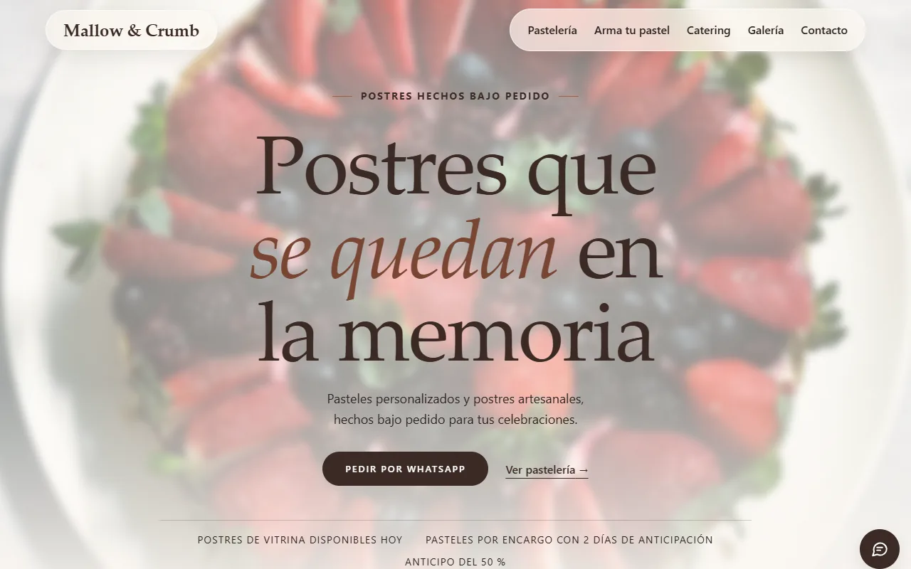
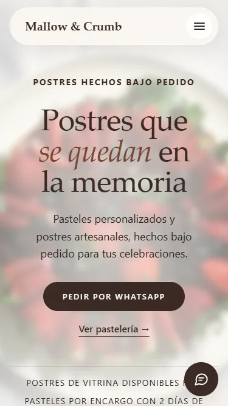
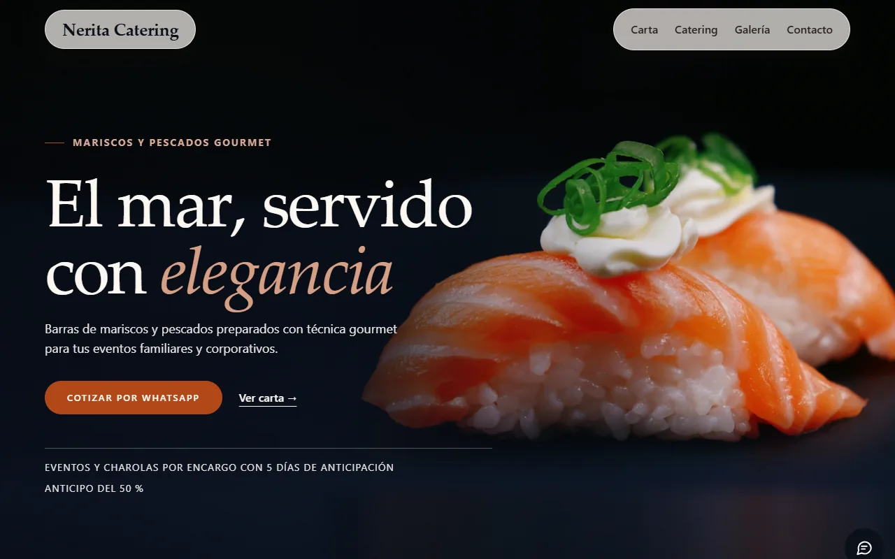
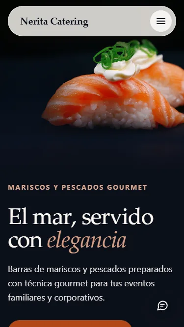

# Restaurant landing template

[](https://github.com/arqsam/restaurant-landing-template/actions/workflows/ci.yml)

Plantilla de landing page para **pastelerías, restaurantes y servicios de catering**, hecha con **React + TypeScript + Vite**. Todo el contenido (marca, colores, menú, horarios, pedidos) se cambia editando un único archivo tipado: `src/content/site.ts`. WhatsApp es el canal principal de pedido; un formulario de cotización registra la solicitud por correo.

## Demos

| Demo                                                               | Negocio (ficticio)                                            | Estilo                |
| ------------------------------------------------------------------ | ------------------------------------------------------------- | --------------------- |
| [mallow-and-crumb.vercel.app](https://mallow-and-crumb.vercel.app) | **Mallow & Crumb**, pastelería con personalizador de pasteles | Cálido, claro         |
| [nerita-catering.vercel.app](https://nerita-catering.vercel.app)   | **Nerita Catering**, barras de mariscos para eventos          | Elegante, hero oscuro |

Son dos configuraciones de la misma plantilla: solo cambia el contenido de `site.ts` (la segunda vive en `src/content/samples/catering.ts`).

> **Los datos de ejemplo no son reales.** Las dos marcas, sus direcciones, teléfonos, correos, precios y reseñas son ficticios y están marcados como muestra. Antes de publicar un sitio para un negocio real hay que reemplazarlos todos (ver la guía de entrega al final).

## Capturas

Primera pantalla de cada demo en escritorio (1280 px) y móvil (375 px).

**Mallow & Crumb** (pastelería)

<table>
  <tr>
    <td></td>
    <td></td>
  </tr>
</table>

**Nerita Catering** (barras de mariscos, hero oscuro)

<table>
  <tr>
    <td></td>
    <td></td>
  </tr>
</table>

## Qué incluye

- Header con navegación y scroll suave (respeta `prefers-reduced-motion`), hero con CTA de WhatsApp, menú por categorías con precios en MXN y etiquetas de dieta, destacados, paquetes de catering o pasteles por encargo, "Cómo pedir", galería, testimonios, horarios con "Abierto ahora", FAQ con acordeón accesible, contacto y formulario.
- **Personalizador "Arma tu pedido"** (opcional): tamaño, sabor, relleno y decoración, con total estimado, anticipo y saldo. No cobra; el pago se acuerda por WhatsApp.
- **Formulario de cotización** con validación por campo, anti-spam (campo honeypot) y respaldo: si el envío falla, la persona puede continuar por WhatsApp con el resumen ya escrito.
- **SEO** generado desde la configuración: título, Open Graph, URL canónica y datos estructurados `schema.org` (`Bakery`, `Restaurant` o `FoodEstablishment`).
- **Rendimiento**: fotos en WebP con dimensiones y variantes `srcset`, peso de la primera carga menor a 1.5 MB (se mide con `npm run weight`).
- Accesible (contraste AA, foco visible, teclado) y responsive de 320 a 1440 px.
- Sin librerías de UI ni fuentes externas: CSS Modules y fuentes del sistema.

## Inicio rápido

Requisitos: **Node.js 24** (hay un `.nvmrc`; con `nvm`, `nvm use`) y npm.

```bash
npm install
npm run dev
```

| Comando                  | Qué hace                                                                |
| ------------------------ | ----------------------------------------------------------------------- |
| `npm run dev`            | Servidor de desarrollo con la pastelería de ejemplo                     |
| `npm run dev:catering`   | Lo mismo con la configuración de catering                               |
| `npm run build`          | Revisión de tipos (`tsc -b`) y build de producción                      |
| `npm run build:catering` | Build de producción de la configuración de catering                     |
| `npm run preview`        | Sirve la carpeta `dist` ya compilada                                    |
| `npm run weight`         | Estima el peso de la primera carga del `dist` compilado (límite 1.5 MB) |
| `npm run lint`           | ESLint                                                                  |
| `npm test`               | Pruebas con Vitest (una sola ejecución)                                 |
| `npm run test:watch`     | Pruebas en modo observación                                             |

## Personaliza esta plantilla en 5 pasos

Tiempo estimado para un negocio con su menú y fotos listos: **menos de 2 horas**. Todo se hace en `src/content/site.ts` salvo las fotos (`public/images/`) y la llave del formulario.

### 1. Marca, colores y SEO

En `brand` y `seo`:

```ts
brand: {
  name: "Tu Negocio",
  type: "bakery", // "bakery" | "restaurant" | "catering": decide el tipo de schema.org
  tagline: "Frase corta",
  colors: { primary: "#3b2a24", accent: "#c26a4a" },
},
seo: {
  title: "Tu Negocio | Qué vendes en tu ciudad",
  description: "Una o dos frases que Google mostrará debajo del título.",
  siteUrl: "https://tu-dominio.com", // sin barra final
  address: { /* dirección estructurada para Google */ },
},
```

- La plantilla tiene **dos colores de marca**. `primary` se usa en fondos oscuros y títulos de marca; `accent` en los botones. El color del texto sobre cada uno y la variante de `accent` para texto sobre fondo claro se calculan solos para cumplir contraste AA.
- Los neutros (fondo crema, grises, bordes) son fijos y viven en `src/styles/tokens.css`. Si la marca necesita otro fondo, se cambian ahí.
- Los textos de cada sección (`menuIntro`, `cateringIntro`, `contactIntro`, `nav.menuLabel`, etc.) están en el mismo archivo.
- Para un hero con foto de fondo oscuro, usa `hero.tone: "dark"` (como en la demo de catering).
- Cambia también el favicon: reemplaza `public/favicon.svg` (o apunta `seo.favicon` a otro archivo de `public/`).

### 2. Menú, paquetes y reglas de pedido

- `menu`: categorías con platillos (`id` único, nombre, descripción, precio en MXN, etiquetas de dieta y `availability: "vitrina"` para lo que hay hoy o `"encargo"` para lo que se pide con anticipación).
- `featured.itemIds`: los `id` de los platillos que se destacan.
- `packages`: paquetes por persona con mínimo de invitados. Cámbialos a "pasteles por encargo" o "paquetes de evento" según el negocio.
- `orders`: número de WhatsApp (código de país y sin símbolos: `"525512345678"`), mensaje inicial, `minLeadDays` (anticipación mínima), `depositPercent` (anticipo) y las condiciones de pago.
- `hours`: horarios por día y zona horaria (`America/Mexico_City`); con eso se calcula "Abierto ahora".
- `sections`: apaga lo que no uses (`featured`, `customizer`, `catering`, `gallery`, `testimonials`, `faq`). El resto (hero, menú, "Cómo pedir", horarios, contacto y footer) siempre aparece.
- Si no vendes pasteles personalizables, pon `sections.customizer: false` y borra `customizer` y `nav.customizerLabel`.
- Cambiar un precio es editar un número en `menu`: toma 2 minutos.

### 3. Fotos

Reemplaza las imágenes de `public/images/` y actualiza `src`, `srcSet`, `width`, `height` y `alt` en `site.ts`. La guía completa está más abajo (**Guía de fotografía y optimización**); `npm test` te avisa si algo no coincide.

### 4. Contacto y formulario

- En `contact`: correo, dirección, enlace de Google Maps y el proveedor del formulario.
- **Web3Forms** (recomendado, 250 envíos al mes gratis al momento de escribir esto; verifica los límites antes de entregar a un cliente):
  1. En [web3forms.com](https://web3forms.com) escribe el correo donde el negocio quiere recibir las solicitudes; te llega una **llave de acceso** por correo.
  2. Pégala en `contact.formKey` en `site.ts`, **o** guárdala como variable de entorno `VITE_FORM_KEY` (en local, copia `.env.example` a `.env.local`; en Vercel, Settings → Environment Variables y vuelve a desplegar).
  3. Manda una solicitud de prueba y confirma que llega.
- Mientras `formKey` siga empezando con `REEMPLAZA`, el formulario no envía nada y ofrece continuar por WhatsApp.
- La llave de Web3Forms es **pública por diseño** (viaja en el navegador), igual que el identificador de Formspree. No pongas aquí secretos. Detalles en el [ADR 0003](docs/adr/0003-formulario-de-contacto.md).
- **Formspree** también está implementado (`formProvider: "formspree"`, con el identificador del formulario como `formKey`) y probado con respuestas simuladas, pero **no se ha verificado contra el servicio real**: haz una prueba de envío antes de entregarlo.
- El texto breve de privacidad que se muestra bajo el formulario es `contactForm.privacyNote`. Complétalo con el aviso de privacidad del negocio (ver más abajo).

### 5. Publica

1. Comprueba en local: `npm test`, `npm run lint` y `npm run build` (y `npm run weight` después del build).
2. Sube el repositorio a GitHub y en [Vercel](https://vercel.com) elige **Add New → Project**. El preset es **Vite** y no hace falta cambiar nada (build: `npm run build`, salida: `dist`).
3. Agrega `VITE_FORM_KEY` si usas variable de entorno, despliega y copia la URL pública.
4. Pon esa URL (o el dominio propio) en `seo.siteUrl` y vuelve a desplegar: de ahí salen la URL canónica, la imagen al compartir y el JSON-LD.
5. En producción, mide con Lighthouse móvil (ventana de incógnito, mediana de 3 corridas). Meta de la plantilla: Performance ≥ 90 y Accessibility, Best Practices y SEO ≥ 95. Valida el JSON-LD en [validator.schema.org](https://validator.schema.org).

## Guía de fotografía y optimización

Las fotos de comida pesadas son el principal enemigo del rendimiento. Reglas de la plantilla:

- **Formato**: WebP (con [Squoosh](https://squoosh.app) o `cwebp`), calidad 75–82. La imagen para compartir (`seo.ogImage`) es JPG de **1200×630** y menos de 250 KB.
- **Variantes por uso** (se declaran en `srcSet` junto con `sizes`):

| Uso                      | Anchos a exportar             | Notas                                                                       |
| ------------------------ | ----------------------------- | --------------------------------------------------------------------------- |
| Hero                     | 720, 860, 1080, 1440, 1920 px | Foto horizontal 16:9. La de 860 px evita que un móvil común baje la de 1080 |
| Galería y personalizador | 480 y 960 px                  | Recorte vertical 4:5                                                        |
| Miniaturas del menú      | 240 y 480 px                  | Cuadradas (1:1)                                                             |

- **Dimensiones**: cada imagen declara `width` y `height` reales (evita saltos de diseño) y un `alt` descriptivo. El descriptor de cada variante en `srcSet` (por ejemplo `480w`) debe ser el ancho real del archivo.
- **Peso máximo por archivo**: hasta 480 px, 60 KB; hasta 960, 160 KB; hasta 1080, 200 KB; hasta 1440, 300 KB; más, 500 KB.
- **Carga**: solo el hero se carga de inmediato (con preload). El resto usa `loading="lazy"`.
- **Qué fotos conviene pedir**: luz natural, fondo limpio, el platillo ocupa casi todo el encuadre y hay espacio libre para el texto en el hero.
- `npm test` revisa que todo lo anterior se cumpla contra los archivos reales (`scripts/images.test.ts`), y `npm run weight` mide la primera carga del sitio compilado.
- **Créditos**: las fotos de las demos son de Pexels y sus autores están en [docs/04-image-credits.md](docs/04-image-credits.md). Reemplázalas por las del cliente.

## Aviso de privacidad de ejemplo

El formulario recolecta datos personales, así que el sitio de un negocio real debe publicar un aviso de privacidad. Este es un **punto de partida** que el negocio debe adaptar y, si es posible, revisar con quien lo asesore legalmente; no es asesoría legal.

> **Aviso de privacidad**
>
> **[Nombre del negocio]**, con domicilio en **[dirección]**, es responsable del tratamiento de tus datos personales.
>
> **Datos que recabamos:** nombre, número de WhatsApp, correo electrónico (opcional) y los datos de tu solicitud (tipo de pedido, fecha, número de personas, forma de entrega y mensaje).
>
> **Para qué los usamos:** únicamente para responder tu solicitud de cotización o pedido y darle seguimiento.
>
> **Con quién se comparten:** el formulario se envía a través de **[Web3Forms / Formspree]**, que nos lo entrega por correo electrónico. No vendemos ni compartimos tus datos con terceros para fines publicitarios.
>
> **Este sitio no usa cookies de seguimiento ni herramientas de analítica.** El servicio de alojamiento puede registrar datos técnicos de la visita (como la dirección IP) con fines de seguridad.
>
> **Tus derechos:** puedes acceder, rectificar o cancelar tus datos, u oponerte a su uso, escribiendo a **[correo del negocio]**. Si quieres que borremos tu solicitud, indícanoslo por el mismo medio.
>
> Cualquier cambio a este aviso se publicará en esta página. **Última actualización:** [fecha].

Dónde ponerlo: como página aparte (por ejemplo `/aviso-de-privacidad`) enlazada desde el footer, o en el servicio de alojamiento del negocio. La plantilla no incluye esa página, solo la nota corta bajo el formulario (`contactForm.privacyNote`).

## Configuraciones de ejemplo y cómo quitarlas

La plantilla incluye dos configuraciones para demostrar que se personaliza solo con `site.ts` ([ADR 0007](docs/adr/0007-segunda-configuracion-por-modo.md)): la pastelería (`src/content/site.ts`, es la que usan `npm run dev` y `npm run build`) y el catering (`src/content/samples/catering.ts`, modo `catering` de Vite).

**Un negocio real puede ignorar la segunda**: edita `site.ts` y despliega con `npm run build`; el código y la configuración de catering no entran en el bundle. Si quieres un repositorio limpio para el cliente:

1. Borra `src/content/samples/`, `src/App.catering.test.tsx`, `public/images/nerita/` y `public/favicon-nerita.svg`.
2. En `src/content/active.ts` deja solo `export { site } from "./site.ts";` (o importa `site` directamente en `src/App.tsx` y borra `active.ts`).
3. En `vite.config.ts` quita el import de `cateringSite` y deja `site = bakerySite` en `seoHead()` (renombra la variable si quieres).
4. En `package.json` borra los scripts `dev:catering` y `build:catering`.
5. En `scripts/images.test.ts` deja solo la configuración del cliente en `SITES`; en `src/components/ContactForm/ContactForm.test.tsx` quita las pruebas que usan `cateringSite`.
6. Corre `npm test`, `npm run lint` y `npm run build` para confirmar que no quedó ninguna referencia.

## Estructura del proyecto

```text
src/
  content/       site.ts (la configuración), types.ts, samples/ (catering), active.ts
  components/    una carpeta por sección (Hero, Menu, Catering, ContactForm…)
  hooks/         useContactForm, useOrderBuilder
  lib/           lógica pura y con pruebas (dinero, horarios, pedido, SEO, formulario)
  styles/        tokens de diseño y estilos base (CSS Modules por componente)
public/images/   fotos WebP por configuración
scripts/         auditoría de imágenes y estimación de peso
docs/            PRD, especificación, ADR y reporte de aceptación
```

## Guía de entrega a un cliente

Antes de entregar o publicar un sitio para un negocio real:

- [ ] Reemplazar **todos** los datos de ejemplo: nombre, dirección, teléfono, correo, menú, precios, horarios y FAQ.
- [ ] Poner el número real de WhatsApp en `orders.whatsapp` y probar el botón flotante y el de cada platillo.
- [ ] Reemplazar los testimonios de muestra por reseñas reales (con permiso) o apagar `sections.testimonials`. Los de la plantilla están marcados con `isSample: true` y se muestran como ejemplo.
- [ ] Reemplazar fotos y créditos (`docs/04-image-credits.md`) y actualizar favicon e imagen para compartir.
- [ ] Crear la llave del formulario con el correo del negocio y hacer una prueba real de envío.
- [ ] Publicar el aviso de privacidad y enlazarlo.
- [ ] Poner `seo.siteUrl` con el dominio final y volver a desplegar.
- [ ] Correr `npm test`, `npm run lint`, `npm run build` y `npm run weight`; medir Lighthouse móvil en producción.
- [ ] Confirmar que el sitio **no publica datos bancarios** (CLABE o cuentas): los datos de pago se envían por WhatsApp al confirmar el pedido ([ADR 0004](docs/adr/0004-personalizador-y-anticipo.md)).
- [ ] Explicar al cliente cómo cambiar precios y horarios (un archivo, `site.ts`) y quién hace el despliegue.

## Documentación

- [PRD](docs/01-prd.md)
- [Especificación técnica](docs/02-technical-spec.md)
- [Reporte de aceptación](docs/03-acceptance-report.md)
- [Créditos de imágenes](docs/04-image-credits.md)
- [Issues planeados](docs/issues.md)
- Decisiones: [ADR](docs/adr/)

Proyecto de portafolio desarrollado con Spec-Driven Development: cada issue referencia un criterio de aceptación del PRD y cada cambio entra por un pull request.

## Licencia

[MIT](LICENSE).
